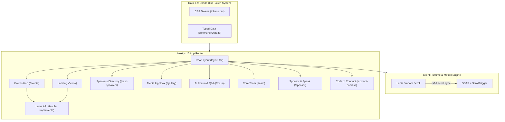
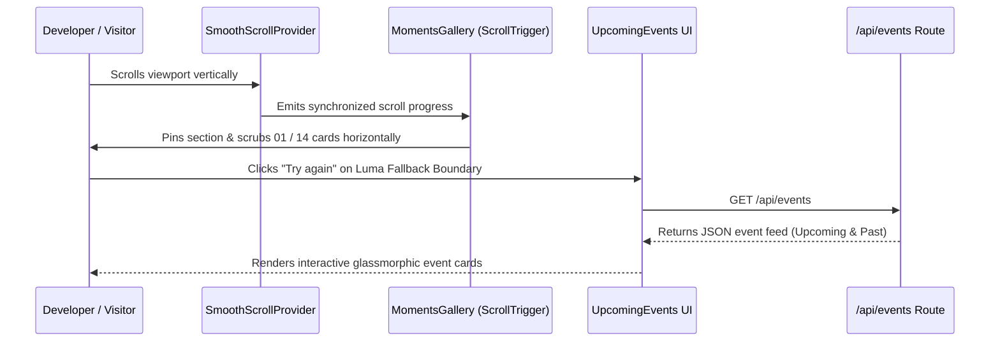
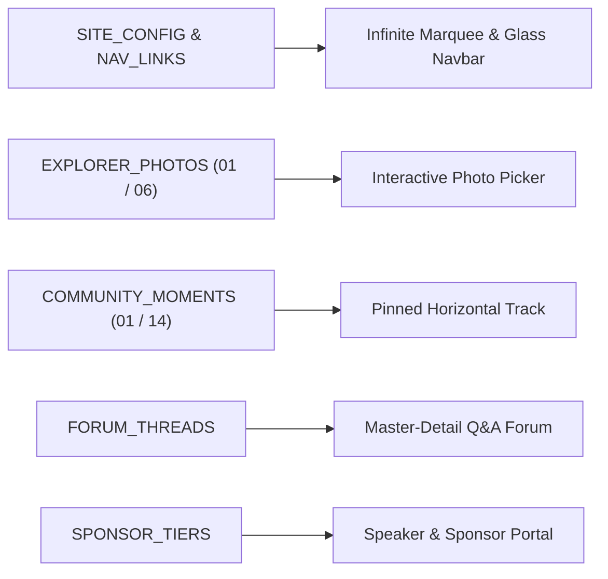

<div align="center">
  

  <br />

  
  
  
  
  
</div>


## Overview

**AI GEEKS** is a modern developer community platform engineered with **Next.js 16**, **React 19**, **TypeScript**, **Tailwind CSS v4**, **GSAP ScrollTrigger**, and **Lenis** smooth scroll interpolation. Re-architected from the open-source Chennai React community stack and styled in a custom **9-Shade Blue Glassmorphic Design System**, the platform powers live Luma event calendars, interactive meetup galleries, speaker directories, sponsorship portals, and an AI engineering Q&A forum.


## System & Component Architecture

The platform separates static and dynamic rendering across the Next.js App Router, synchronizing smooth scroll inertia with pinned GSAP timelines and a centralized TypeScript data layer.



### Interactive Scroll & Luma Feed Lifecycle



### Community Feature & Data Flow




## 9-Shade Blue Glassmorphic Color System

Every surface, border, gradient, and glow state in the repository is strictly mapped to nine hex shades defined in **src/styles/tokens.css**.

| CSS Custom Property | Hex Code | Palette Name | Primary Architectural Role |
| :--- | :--- | :--- | :--- |
| --ag-bg-abyss | #000521 | Abyssal Navy | Primary viewport background canvas |
| --ag-bg-void | #020024 | Midnight Void | Alternating section and footer canvas |
| --ag-bg-obsidian | #020C47 | Obsidian Royal | Elevated glassmorphic card base |
| --ag-bg-cyber | #0A1A2F | Cyber Slate Navy | Translucent surface panel tint |
| --ag-blue-imperial | #011F65 | Imperial Cobalt | Active route pills and secondary buttons |
| --ag-blue-sapphire | #0E4EB2 | Core Sapphire | Interactive hover fill and CTA midpoint |
| --ag-blue-azure | #2078CF | Vibrant Azure | Primary CTA gradient lead and borders |
| --ag-cyan-electric | #00D4FF | Electric Cyan | Monospace eyebrows, badges, and rim glows |
| --ag-neutral-carbon | #1F1F1F | Carbon Dark | Terminal header bars, code blocks, and dividers |


## Route & Module Matrix

| Route Path | Source File | Interactive Capabilities |
| :--- | :--- | :--- |
| / | src/app/page.tsx | 3D Mascot tilt hero, Luma feed, 01/06 photo picker, 01/14 GSAP gallery |
| /about | src/app/about/page.tsx | Community pillars, 10k+ member metrics, and builder mission |
| /events | src/app/events/page.tsx | Upcoming and past meetup tabs wired to the Luma API handler |
| /past-speakers | src/app/past-speakers/page.tsx | Live text search and category filtering across speaker sessions |
| /gallery | src/app/gallery/page.tsx | Photo and video media archive with modal lightbox player |
| /forum | src/app/forum/page.tsx | Master-detail AI Q&A forum with upvotes, thread creation, and replies |
| /team | src/app/team/page.tsx | 17-member core organizing team grid with role badges |
| /sponsor | src/app/sponsor/page.tsx | Sponsorship prospectus tiers and speaker proposal onboarding form |
| /code-of-conduct | src/app/code-of-conduct/page.tsx | Community safety standards and enforcement guidelines |


## Quick Start & Automated Verification

1. **Install Dependencies**
   ```bash
   npm install
   ```

2. **Start the Development Server**
   ```bash
   npm run dev
   ```

3. **Run the Automated Clone & README Verification Suite**
   ```bash
   npm run verify:readme
   npm run verify:clone
   npm run build
   ```
