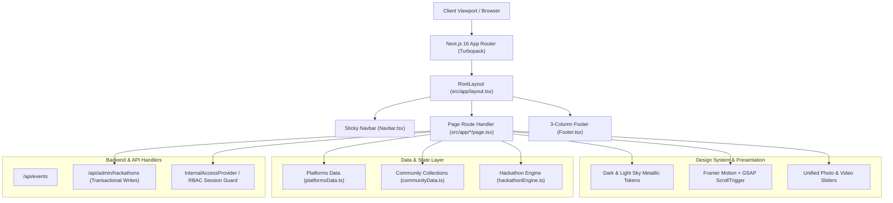

# AI GEEKS Platform Architecture & Technical Design

**Project:** AI GEEKS Community Platform  
**Runtime:** Next.js 16.4.6 (Turbopack) / React 19 / Node.js 24  
**Architecture Pattern:** Layered Component & Server-Side Functional Core  

---

## 1. High-Level Architecture Diagram

---

## 2. Core Architectural Principles

### 1. Dual-Audience Visual Separation
- **Public Community Website:** Elegant editorial layout, human-centered photography, interactive photo stack, motion-governed sliders, and minimal card chrome.
- **Internal Community Operations:** High-efficiency command center, multi-tab hackathon consoles, transactional problem statement selection, and real-time analytics distribution charts.

### 2. Next.js 16 Dynamic Parameters Contract
- In Next.js 16, dynamic route segments (`params`) are asynchronous Promises:
  `params: Promise<{ id: string; tab?: string }>`
- All sub-routes (`/admin/hackathons/[id]`, `/admin/hackathons/[id]/[tab]`) await `params` before accessing attributes.

### 3. Atomic Problem Statement Selection
- Ensures that a team can only hold one active selection at a time.
- Verifies problem capacity constraints server-side (`maxCapacity`).
- Atomically marks the previous selection as `TRANSFERRED` without double-counting active allocations.

### 4. Zero Brand Leaks Policy
- Strict rebranding verification ensuring no residual strings from reference communities appear in active production code.
- Checked automatically by `scripts/verify-clone.mjs`.

### 5. Multi-Mirror Synchronization & Baseline Invariant
- `AI-GEEKS-ORIGINAL` is strictly immutable.
- `AI-GEEKS-ENHANCED`, `ai-geeks-community-v2`, and parent mirrors are synchronized.
