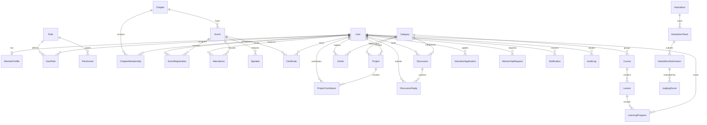

# Relational Database Schema & Data Models Specification
**Project:** AI Geeks Tech Community  
**Document ID:** `DOCS-ARCH-002`  
**Reference Date:** November 17, 2026  
**Status:** Approved Enterprise Relational Schema (33 Entity Models)  

---

## 1. High-Level Entity-Relationship Overview



---

## 2. Exhaustive Data Schema (33 Entity Models)

### Core Identity & Access Control
```sql
-- 1. Users
CREATE TABLE users (
    id VARCHAR(64) PRIMARY KEY,
    email VARCHAR(255) UNIQUE NOT NULL,
    password_hash VARCHAR(255) NOT NULL,
    display_name VARCHAR(120) NOT NULL,
    status VARCHAR(32) DEFAULT 'pending_verification', -- pending_verification, active, suspended
    created_at TIMESTAMP WITH TIME ZONE DEFAULT CURRENT_TIMESTAMP,
    updated_at TIMESTAMP WITH TIME ZONE DEFAULT CURRENT_TIMESTAMP
);

-- 2. Member Profiles
CREATE TABLE member_profiles (
    user_id VARCHAR(64) PRIMARY KEY REFERENCES users(id) ON DELETE CASCADE,
    avatar_url TEXT,
    bio TEXT,
    headline VARCHAR(200),
    github_handle VARCHAR(100),
    twitter_handle VARCHAR(100),
    linkedin_url TEXT,
    portfolio_url TEXT,
    reputation_xp INTEGER DEFAULT 0,
    reputation_tier VARCHAR(32) DEFAULT 'Seed', -- Seed, Builder, Architect, Fellow, Legend
    is_public BOOLEAN DEFAULT TRUE,
    skills TEXT[] DEFAULT '{}',
    interests TEXT[] DEFAULT '{}',
    updated_at TIMESTAMP WITH TIME ZONE DEFAULT CURRENT_TIMESTAMP
);

-- 3. Roles
CREATE TABLE roles (
    id VARCHAR(64) PRIMARY KEY,
    name VARCHAR(64) UNIQUE NOT NULL, -- Guest, Member, Volunteer, Mentor, ContentEditor, EventOrganizer, ChapterLead, Moderator, CommunityAdmin, SuperAdmin
    description TEXT,
    is_system BOOLEAN DEFAULT TRUE
);

-- 4. Permissions
CREATE TABLE permissions (
    id VARCHAR(64) PRIMARY KEY,
    action VARCHAR(100) NOT NULL, -- e.g., 'event:create', 'project:approve', 'audit:view'
    resource VARCHAR(100) NOT NULL
);

-- 5. User Roles (Junction)
CREATE TABLE user_roles (
    user_id VARCHAR(64) REFERENCES users(id) ON DELETE CASCADE,
    role_id VARCHAR(64) REFERENCES roles(id) ON DELETE CASCADE,
    assigned_at TIMESTAMP WITH TIME ZONE DEFAULT CURRENT_TIMESTAMP,
    assigned_by VARCHAR(64) REFERENCES users(id),
    PRIMARY KEY (user_id, role_id)
);
```

### Chapters & Events Platform
```sql
-- 6. Chapters
CREATE TABLE chapters (
    id VARCHAR(64) PRIMARY KEY,
    name VARCHAR(120) NOT NULL,
    slug VARCHAR(120) UNIQUE NOT NULL,
    region VARCHAR(100) NOT NULL,
    city VARCHAR(100),
    lead_user_id VARCHAR(64) REFERENCES users(id),
    description TEXT,
    avatar_url TEXT,
    status VARCHAR(32) DEFAULT 'active', -- active, proposed, inactive
    created_at TIMESTAMP WITH TIME ZONE DEFAULT CURRENT_TIMESTAMP
);

-- 7. Chapter Memberships
CREATE TABLE chapter_memberships (
    chapter_id VARCHAR(64) REFERENCES chapters(id) ON DELETE CASCADE,
    user_id VARCHAR(64) REFERENCES users(id) ON DELETE CASCADE,
    role VARCHAR(32) DEFAULT 'member', -- member, organizer, lead
    joined_at TIMESTAMP WITH TIME ZONE DEFAULT CURRENT_TIMESTAMP,
    PRIMARY KEY (chapter_id, user_id)
);

-- 8. Events
CREATE TABLE events (
    id VARCHAR(64) PRIMARY KEY,
    slug VARCHAR(150) UNIQUE NOT NULL,
    title VARCHAR(200) NOT NULL,
    category VARCHAR(64) NOT NULL, -- Workshop, Meetup, Summit, Hackathon, Webinar
    chapter_id VARCHAR(64) REFERENCES chapters(id),
    description TEXT NOT NULL,
    banner_url TEXT,
    start_time TIMESTAMP WITH TIME ZONE NOT NULL,
    end_time TIMESTAMP WITH TIME ZONE NOT NULL,
    timezone VARCHAR(50) DEFAULT 'UTC',
    venue_type VARCHAR(32) NOT NULL, -- in_person, virtual, hybrid
    venue_address TEXT,
    virtual_meeting_url TEXT, -- confidential to registered users
    capacity INTEGER NOT NULL DEFAULT 100,
    registration_deadline TIMESTAMP WITH TIME ZONE,
    status VARCHAR(32) DEFAULT 'published', -- draft, published, cancelled, completed
    created_by VARCHAR(64) REFERENCES users(id),
    created_at TIMESTAMP WITH TIME ZONE DEFAULT CURRENT_TIMESTAMP
);

-- 9. Event Registrations
CREATE TABLE event_registrations (
    id VARCHAR(64) PRIMARY KEY,
    event_id VARCHAR(64) REFERENCES events(id) ON DELETE CASCADE,
    user_id VARCHAR(64) REFERENCES users(id) ON DELETE CASCADE,
    ticket_token VARCHAR(255) UNIQUE NOT NULL, -- HMAC-SHA256 signature payload
    status VARCHAR(32) DEFAULT 'confirmed', -- confirmed, waitlisted, cancelled
    registered_at TIMESTAMP WITH TIME ZONE DEFAULT CURRENT_TIMESTAMP
);

-- 10. Attendance Records
CREATE TABLE attendance (
    id VARCHAR(64) PRIMARY KEY,
    event_id VARCHAR(64) REFERENCES events(id) ON DELETE CASCADE,
    user_id VARCHAR(64) REFERENCES users(id) ON DELETE CASCADE,
    verified_at TIMESTAMP WITH TIME ZONE DEFAULT CURRENT_TIMESTAMP,
    verified_by VARCHAR(64) REFERENCES users(id),
    checkin_method VARCHAR(32) DEFAULT 'qr_scan' -- qr_scan, manual_organizer
);

-- 11. Speakers
CREATE TABLE speakers (
    id VARCHAR(64) PRIMARY KEY,
    event_id VARCHAR(64) REFERENCES events(id) ON DELETE CASCADE,
    user_id VARCHAR(64) REFERENCES users(id),
    name VARCHAR(120) NOT NULL,
    title VARCHAR(150),
    organization VARCHAR(150),
    bio TEXT,
    avatar_url TEXT,
    topic_title VARCHAR(200)
);

-- 12. Certificates
CREATE TABLE certificates (
    id VARCHAR(64) PRIMARY KEY, -- Public verification ID (e.g., 'CERT-AIG-2026-X89Y')
    recipient_user_id VARCHAR(64) REFERENCES users(id) ON DELETE CASCADE,
    event_id VARCHAR(64) REFERENCES events(id),
    title VARCHAR(200) NOT NULL,
    issuer_name VARCHAR(120) DEFAULT 'AI Geeks Community Foundation',
    issued_date DATE NOT NULL,
    cryptographic_hash VARCHAR(128) UNIQUE NOT NULL,
    is_revoked BOOLEAN DEFAULT FALSE,
    revocation_reason TEXT
);
```

### Projects & Innovation Ecosystem
```sql
-- 13. Categories (The 20 Structured Topic Domains)
CREATE TABLE categories (
    id VARCHAR(64) PRIMARY KEY,
    slug VARCHAR(100) UNIQUE NOT NULL,
    name VARCHAR(100) NOT NULL,
    description TEXT,
    icon_name VARCHAR(50)
);

-- 14. Projects
CREATE TABLE projects (
    id VARCHAR(64) PRIMARY KEY,
    slug VARCHAR(150) UNIQUE NOT NULL,
    title VARCHAR(150) NOT NULL,
    tagline VARCHAR(250) NOT NULL,
    description TEXT NOT NULL,
    category_id VARCHAR(64) REFERENCES categories(id),
    author_user_id VARCHAR(64) REFERENCES users(id) ON DELETE CASCADE,
    github_url TEXT NOT NULL,
    live_demo_url TEXT,
    thumbnail_url TEXT,
    tech_stack TEXT[] DEFAULT '{}',
    stars_count INTEGER DEFAULT 0,
    status VARCHAR(32) DEFAULT 'published', -- pending_approval, published, rejected
    created_at TIMESTAMP WITH TIME ZONE DEFAULT CURRENT_TIMESTAMP
);

-- 15. Project Contributors
CREATE TABLE project_contributors (
    project_id VARCHAR(64) REFERENCES projects(id) ON DELETE CASCADE,
    user_id VARCHAR(64) REFERENCES users(id) ON DELETE CASCADE,
    role VARCHAR(64) DEFAULT 'Contributor',
    PRIMARY KEY (project_id, user_id)
);
```

### Knowledge, Learning & Discussions
```sql
-- 16. Articles (Blog)
CREATE TABLE articles (
    id VARCHAR(64) PRIMARY KEY,
    slug VARCHAR(180) UNIQUE NOT NULL,
    title VARCHAR(200) NOT NULL,
    content_markdown TEXT NOT NULL,
    excerpt TEXT,
    author_user_id VARCHAR(64) REFERENCES users(id) ON DELETE CASCADE,
    category_id VARCHAR(64) REFERENCES categories(id),
    reading_time_minutes INTEGER DEFAULT 5,
    views_count INTEGER DEFAULT 0,
    likes_count INTEGER DEFAULT 0,
    status VARCHAR(32) DEFAULT 'published',
    published_at TIMESTAMP WITH TIME ZONE DEFAULT CURRENT_TIMESTAMP
);

-- 17. Discussions (Q&A & Community Threads)
CREATE TABLE discussions (
    id VARCHAR(64) PRIMARY KEY,
    title VARCHAR(250) NOT NULL,
    content_markdown TEXT NOT NULL,
    category_id VARCHAR(64) REFERENCES categories(id),
    author_user_id VARCHAR(64) REFERENCES users(id) ON DELETE CASCADE,
    votes_score INTEGER DEFAULT 0,
    views_count INTEGER DEFAULT 0,
    is_solved BOOLEAN DEFAULT FALSE,
    accepted_reply_id VARCHAR(64),
    status VARCHAR(32) DEFAULT 'active', -- active, locked, archived
    created_at TIMESTAMP WITH TIME ZONE DEFAULT CURRENT_TIMESTAMP
);

-- 18. Discussion Replies
CREATE TABLE discussion_replies (
    id VARCHAR(64) PRIMARY KEY,
    discussion_id VARCHAR(64) REFERENCES discussions(id) ON DELETE CASCADE,
    author_user_id VARCHAR(64) REFERENCES users(id) ON DELETE CASCADE,
    content_markdown TEXT NOT NULL,
    votes_score INTEGER DEFAULT 0,
    is_accepted_answer BOOLEAN DEFAULT FALSE,
    created_at TIMESTAMP WITH TIME ZONE DEFAULT CURRENT_TIMESTAMP
);

-- 19. Courses (Learning Academy)
CREATE TABLE courses (
    id VARCHAR(64) PRIMARY KEY,
    slug VARCHAR(120) UNIQUE NOT NULL,
    title VARCHAR(150) NOT NULL,
    description TEXT NOT NULL,
    category_id VARCHAR(64) REFERENCES categories(id),
    difficulty VARCHAR(32) DEFAULT 'Intermediate', -- Beginner, Intermediate, Advanced
    estimated_hours INTEGER DEFAULT 10,
    xp_reward INTEGER DEFAULT 50,
    created_at TIMESTAMP WITH TIME ZONE DEFAULT CURRENT_TIMESTAMP
);

-- 20. Lessons
CREATE TABLE lessons (
    id VARCHAR(64) PRIMARY KEY,
    course_id VARCHAR(64) REFERENCES courses(id) ON DELETE CASCADE,
    title VARCHAR(150) NOT NULL,
    sort_order INTEGER NOT NULL,
    content_markdown TEXT NOT NULL,
    code_starter TEXT,
    video_embed_url TEXT
);

-- 21. Learning Progress
CREATE TABLE learning_progress (
    user_id VARCHAR(64) REFERENCES users(id) ON DELETE CASCADE,
    lesson_id VARCHAR(64) REFERENCES lessons(id) ON DELETE CASCADE,
    is_completed BOOLEAN DEFAULT TRUE,
    completed_at TIMESTAMP WITH TIME ZONE DEFAULT CURRENT_TIMESTAMP,
    PRIMARY KEY (user_id, lesson_id)
);
```

### Hackathons, Opportunities, Mentorship & Administration
```sql
-- 22. Hackathons
CREATE TABLE hackathons (
    id VARCHAR(64) PRIMARY KEY,
    slug VARCHAR(150) UNIQUE NOT NULL,
    title VARCHAR(180) NOT NULL,
    tagline VARCHAR(250),
    description TEXT NOT NULL,
    prize_pool_display VARCHAR(100),
    start_time TIMESTAMP WITH TIME ZONE NOT NULL,
    end_time TIMESTAMP WITH TIME ZONE NOT NULL,
    status VARCHAR(32) DEFAULT 'active' -- upcoming, active, judging, concluded
);

-- 23. Hackathon Teams
CREATE TABLE hackathon_teams (
    id VARCHAR(64) PRIMARY KEY,
    hackathon_id VARCHAR(64) REFERENCES hackathons(id) ON DELETE CASCADE,
    name VARCHAR(100) NOT NULL,
    lead_user_id VARCHAR(64) REFERENCES users(id),
    created_at TIMESTAMP WITH TIME ZONE DEFAULT CURRENT_TIMESTAMP
);

-- 24. Hackathon Submissions
CREATE TABLE hackathon_submissions (
    id VARCHAR(64) PRIMARY KEY,
    hackathon_id VARCHAR(64) REFERENCES hackathons(id) ON DELETE CASCADE,
    team_id VARCHAR(64) REFERENCES hackathon_teams(id) ON DELETE CASCADE,
    title VARCHAR(150) NOT NULL,
    description TEXT NOT NULL,
    repo_url TEXT NOT NULL,
    demo_url TEXT,
    final_score NUMERIC(5,2),
    award_title VARCHAR(100),
    submitted_at TIMESTAMP WITH TIME ZONE DEFAULT CURRENT_TIMESTAMP
);

-- 25. Judging Scores
CREATE TABLE judging_scores (
    id VARCHAR(64) PRIMARY KEY,
    submission_id VARCHAR(64) REFERENCES hackathon_submissions(id) ON DELETE CASCADE,
    judge_user_id VARCHAR(64) REFERENCES users(id),
    innovation_score NUMERIC(4,2) NOT NULL,
    technical_execution NUMERIC(4,2) NOT NULL,
    presentation_score NUMERIC(4,2) NOT NULL,
    comments TEXT,
    submitted_at TIMESTAMP WITH TIME ZONE DEFAULT CURRENT_TIMESTAMP
);

-- 26. Volunteer Applications
CREATE TABLE volunteer_applications (
    id VARCHAR(64) PRIMARY KEY,
    user_id VARCHAR(64) REFERENCES users(id) ON DELETE CASCADE,
    program VARCHAR(100) NOT NULL,
    skills TEXT,
    motivation TEXT,
    status VARCHAR(32) DEFAULT 'submitted', -- submitted, under_review, accepted, declined
    created_at TIMESTAMP WITH TIME ZONE DEFAULT CURRENT_TIMESTAMP
);

-- 27. Mentorship Requests
CREATE TABLE mentorship_requests (
    id VARCHAR(64) PRIMARY KEY,
    mentee_user_id VARCHAR(64) REFERENCES users(id) ON DELETE CASCADE,
    mentor_user_id VARCHAR(64) REFERENCES users(id) ON DELETE CASCADE,
    topic VARCHAR(150) NOT NULL,
    message TEXT NOT NULL,
    status VARCHAR(32) DEFAULT 'pending', -- pending, accepted, rejected, completed
    created_at TIMESTAMP WITH TIME ZONE DEFAULT CURRENT_TIMESTAMP
);

-- 28. Opportunities (Jobs / Internships)
CREATE TABLE opportunities (
    id VARCHAR(64) PRIMARY KEY,
    title VARCHAR(150) NOT NULL,
    company_name VARCHAR(150) NOT NULL,
    location VARCHAR(120) NOT NULL,
    job_type VARCHAR(32) NOT NULL, -- Full-time, Remote, Internship, Contract
    salary_range VARCHAR(80),
    apply_url TEXT,
    description TEXT NOT NULL,
    is_verified BOOLEAN DEFAULT TRUE,
    posted_at TIMESTAMP WITH TIME ZONE DEFAULT CURRENT_TIMESTAMP
);

-- 29. Notifications
CREATE TABLE notifications (
    id VARCHAR(64) PRIMARY KEY,
    user_id VARCHAR(64) REFERENCES users(id) ON DELETE CASCADE,
    title VARCHAR(150) NOT NULL,
    message TEXT NOT NULL,
    target_url TEXT,
    is_read BOOLEAN DEFAULT FALSE,
    created_at TIMESTAMP WITH TIME ZONE DEFAULT CURRENT_TIMESTAMP
);

-- 30. Partners & Sponsors
CREATE TABLE partners (
    id VARCHAR(64) PRIMARY KEY,
    name VARCHAR(120) NOT NULL,
    tier VARCHAR(64) NOT NULL, -- Founding Partner, Cloud Infrastructure, Community Affiliate
    logo_url TEXT NOT NULL,
    website_url TEXT NOT NULL,
    is_active BOOLEAN DEFAULT TRUE
);

-- 31. Contact Inquiries
CREATE TABLE contact_inquiries (
    id VARCHAR(64) PRIMARY KEY,
    sender_name VARCHAR(120) NOT NULL,
    sender_email VARCHAR(255) NOT NULL,
    category VARCHAR(64) NOT NULL, -- General, Sponsorship, Speaking, Press
    message TEXT NOT NULL,
    is_resolved BOOLEAN DEFAULT FALSE,
    created_at TIMESTAMP WITH TIME ZONE DEFAULT CURRENT_TIMESTAMP
);

-- 32. Newsletter Subscriptions
CREATE TABLE newsletter_subscriptions (
    email VARCHAR(255) PRIMARY KEY,
    subscribed_at TIMESTAMP WITH TIME ZONE DEFAULT CURRENT_TIMESTAMP,
    consent_recorded BOOLEAN DEFAULT TRUE,
    is_active BOOLEAN DEFAULT TRUE
);

-- 33. Security Audit Logs
CREATE TABLE audit_logs (
    id VARCHAR(64) PRIMARY KEY,
    actor_user_id VARCHAR(64) REFERENCES users(id),
    action VARCHAR(100) NOT NULL, -- e.g., 'user.role_change', 'event.publish', 'content.moderate'
    resource_type VARCHAR(64) NOT NULL,
    resource_id VARCHAR(64) NOT NULL,
    details_json JSONB,
    ip_hash VARCHAR(64),
    created_at TIMESTAMP WITH TIME ZONE DEFAULT CURRENT_TIMESTAMP
);
```
