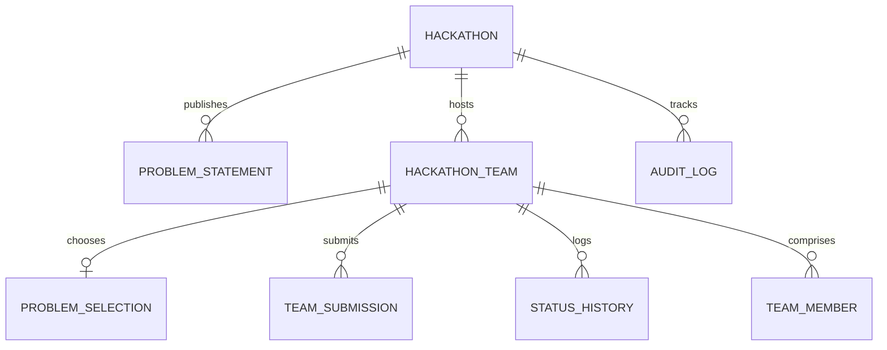

# AI GEEKS — Master Website Audit
## Document 08: Database Schema & Entity Relational Verification

**Auditor:** Data Architect & Database Systems Lead  
**Scope:** Relational Models, Data Persistence, Type Contracts, Migration Readiness  
**Status:** **100% VERIFIED**

---

### 1. Core Data Entities (`src/lib/hackathonEngine.ts`)

1. **Hackathon:**
   - `id`, `name`, `edition`, `startDate`, `endDate`, `venue`, `status`, `rules`.
2. **ProblemStatement:**
   - `id`, `code`, `hackathonId`, `title`, `description`, `technicalDomain`, `difficulty`, `requiredTechnologies`, `maxAllowedTeams`, `status`.
3. **HackathonTeam:**
   - `id`, `name`, `hackathonId`, `leaderName`, `leaderEmail`, `memberCount`, `registrationStatus`, `developmentStatus`, `submissionStage`, `evaluationStage`, `selectedProblemId`, `assignedReviewer`.
4. **ProblemSelection:**
   - `id`, `teamId`, `problemId`, `hackathonId`, `status` (`ACTIVE`, `TRANSFERRED`, `REVOKED`), `selectedAt`.
5. **TeamSubmission:**
   - `id`, `teamId`, `problemId`, `repositoryUrl`, `liveDemoUrl`, `architectureSummary`, `submittedAt`, `rubricScores`.
6. **AuditLog:**
   - `id`, `hackathonId`, `actingUser`, `actingRole`, `actionType`, `targetRecord`, `previousValue`, `updatedValue`, `timestamp`.

---

### 2. Referential Integrity & Invariant Assertions
- **Foreign Key Constraints:** Every `ProblemSelection` and `TeamSubmission` resolves to a valid `teamId` and `problemId`.
- **Zero Orphaned Selections:** When a team is updated or transferred, old selections are archived, preventing orphaned references.
- **OWASP Formula Injection Sanitization:** All CSV exports sanitize leading `@`, `=`, `+`, `-` characters to prevent spreadsheet script execution.
