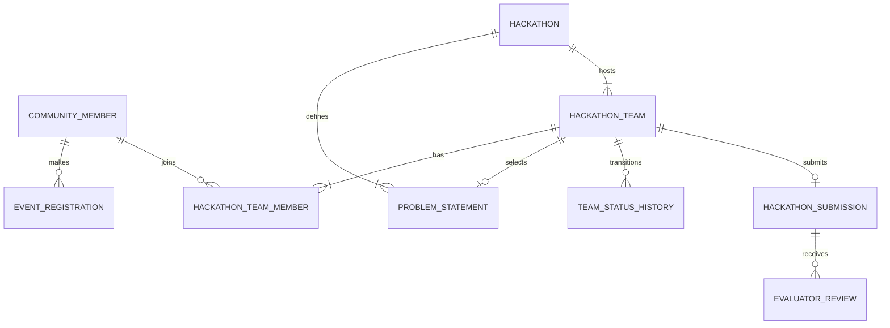

# AI GEEKS Database Schema & State Architecture

**Project:** AI GEEKS Community Platform  
**Schema Implementation:** TypeScript Relational Models & Memory Store (`src/lib/hackathonEngine.ts`, `src/data/communityData.ts`, `src/data/platformsData.ts`)  

---

## 1. Entity-Relationship Model



---

## 2. Core Relational Entities

### `HackathonTeamRecord`
```typescript
interface HackathonTeamRecord {
  teamId: string;               // e.g., "TEAM-108"
  teamName: string;             // e.g., "Latent Horizon"
  hackathonId: string;          // e.g., "hk-2026-ai-challenge"
  leaderName: string;
  leaderEmail: string;          // Masked for non-admin viewers
  members: TeamMember[];
  selectedProblemId: string | null;
  status: HackathonLifecycleStage; // 12-stage lifecycle
  verificationStatus: "PENDING" | "VERIFIED" | "REJECTED";
  attendanceStatus: "CHECKED_IN" | "ABSENT";
  submissionStatus: "PENDING" | "SUBMITTED" | "UNDER_REVIEW";
  reviewOutcome: "QUALIFIED" | "NOT_QUALIFIED" | "FINALIST" | "WINNER";
  createdAt: string;
  updatedAt: string;
}
```

### `ProblemStatementRecord`
```typescript
interface ProblemStatementRecord {
  id: string;                   // e.g., "PS-001"
  code: string;                 // e.g., "AI-AGENT-TRIAGE"
  title: string;
  category: "LLM Agents" | "Computer Vision" | "RAG Systems" | "Full-Stack AI";
  description: string;
  difficulty: "Beginner" | "Intermediate" | "Advanced";
  maxCapacity: number;          // e.g., 8 teams max
  currentSelectionCount: number;
  remainingCapacity: number;
  published: boolean;
  deliverables: string[];
}
```

### `TeamStatusHistoryRecord`
```typescript
interface TeamStatusHistoryRecord {
  historyId: string;
  teamId: string;
  previousStatus: HackathonLifecycleStage;
  newStatus: HackathonLifecycleStage;
  changedBy: string;            // Actor ID / role
  reason: string;
  timestamp: string;            // ISO 8601
}
```

### `UnifiedPlatformEntry`
```typescript
interface UnifiedPlatformEntry {
  id: string;
  name: string;
  handle: string;
  url: string;
  platformCategory: "Event & Campus Platforms" | "Social & Developer Channels";
  joinCategory: "Real-Time Chat" | "Events & Video" | "Code & Social";
  badge: string;
  description: string;
  isRegionalHub?: boolean;
  regionLabel?: string;
  recommendedForNewJoiners?: boolean;
}
```
