# Complete Website Information Architecture & Sitemap
**Project:** AI Geeks Tech Community  
**Document ID:** `DOCS-DES-001`  
**Reference Date:** November 17, 2026  
**Status:** Canonical Routing Specification  

---

## 1. High-Level Routing Tree

```mermaid
flowchart TD
    Root["AI GEEKS WEB PLATFORM"] --> Public["A. Public Website"]
    Root --> Member["B. Authenticated Member Platform"]
    Root --> Ops["C. Community Operations (Organizer Portal)"]
    Root --> Admin["D. Administration Command Center"]
    Root --> Utilities["E. Standalone Public Utilities"]

    Public --> P1["/ (Home)"]
    Public --> P2["/about (About Community)"]
    Public --> P3["/team (Our Team & Leads)"]
    Public --> P4["/chapters (Chapters Directory)"]
    Public --> P5["/events (Events & Meetups)"]
    Public --> P6["/events/[slug] (Event Details)"]
    Public --> P7["/community (Community & Directory)"]
    Public --> P8["/projects (Projects Showcase)"]
    Public --> P9["/projects/[slug] (Project Details)"]
    Public --> P10["/learn (Learning Academy)"]
    Public --> P11["/research (Research Hub)"]
    Public --> P12["/blog (Technical Articles)"]
    Public --> P13["/hackathons (Hackathons & Bounties)"]
    Public --> P14["/opportunities (AI Jobs & Internships)"]
    Public --> P15["/mentorship (Mentorship Directory)"]
    Public --> P16["/labs (Innovation Lab Demos)"]
    Public --> P17["/partners (Partners & Sponsors)"]
    Public --> P18["/gallery (Community Photo/Video)"]
    Public --> P19["/contact (Contact & Inquiries)"]
    Public --> P20["/join (Membership Onboarding)"]
    Public --> P21["/faq (Frequently Asked Questions)"]
    Public --> P22["/policies (Privacy, Terms, Conduct, A11y)"]

    Member --> M1["/dashboard (Overview)"]
    Member --> M2["/dashboard/profile (Profile Editor)"]
    Member --> M3["/dashboard/events (My Registered Passes)"]
    Member --> M4["/dashboard/projects (My Showcased Projects)"]
    Member --> M5["/dashboard/learning (My Enrolled Courses)"]
    Member --> M6["/dashboard/achievements (XP & Tiers)"]
    Member --> M7["/dashboard/notifications (Alerts Center)"]
    Member --> M8["/dashboard/opportunities (My Applications)"]
    Member --> M9["/dashboard/discussions (My Authored Threads)"]
    Member --> M10["/dashboard/settings (Security & Privacy)"]

    Ops --> O1["/organizer (Overview & Stats)"]
    Ops --> O2["/organizer/events (Event Publishing & Drafts)"]
    Ops --> O3["/organizer/members (Chapter Member Roster)"]
    Ops --> O4["/organizer/chapters (Chapter Profile Settings)"]
    Ops --> O5["/organizer/attendance (QR Check-in Scanner)"]
    Ops --> O6["/organizer/reports (Post-Event Analytics)"]

    Admin --> A1["/admin (Command Center)"]
    Admin --> A2["/admin/users (User Accounts & Roles)"]
    Admin --> A3["/admin/roles (Granular Permissions Matrix)"]
    Admin --> A4["/admin/events (Global Event Moderation)"]
    Admin --> A5["/admin/chapters (Chapter Approvals)"]
    Admin --> A6["/admin/content (CMS: Homepage, FAQs)"]
    Admin --> A7["/admin/projects (Project Submissions Queue)"]
    Admin --> A8["/admin/learning (Curriculum Editor)"]
    Admin --> A9["/admin/hackathons (Competition Rubrics)"]
    Admin --> A10["/admin/applications (Volunteer/Mentor Review)"]
    Admin --> A11["/admin/partners (Sponsorship Listings)"]
    Admin --> A12["/admin/moderation (Flagged Content Queue)"]
    Admin --> A13["/admin/analytics (Platform Telemetry)"]
    Admin --> A14["/admin/settings (System Configuration)"]
    Admin --> A15["/admin/audit-logs (Security Audit Trail)"]

    Utilities --> U1["/badge (DevFest 2x Retina Badge Studio)"]
    Utilities --> U2["/verify/[certId] (Certificate Authenticator)"]
    Utilities --> U3["/assistant (Grounded AI Community Assistant)"]
```

---

## 2. Granular Route Specifications

### A. Public Routes
1. `/`: Flagship portal incorporating all 15 Phase 05 sections.
2. `/about`: Founding story, values, Code of Conduct summary, verified growth milestones.
3. `/team`: Core organizing committee, technical advisory council, chapter directors.
4. `/chapters`: Searchable directory of campus and regional chapters (e.g., Delhi, SF, Bengaluru, London, Munich) with chapter lead bios and local upcoming meetups.
5. `/events`: Filterable calendar (In-person, Virtual, Workshop, Summit, Hackathon) with dynamic seat counter and RSVP triggers.
6. `/events/[slug]`: Rich agenda timetable, speaker bios, prerequisite checklists, venue location coordinates, and 1-click RSVP pass generator.
7. `/community`: Comprehensive builder directory, reputation leaderboard preview, guidelines, and ways to get involved.
8. `/projects`: Community AI project registry sorted by trending, stars, recent, and technical tags (`WebGPU`, `LLM`, `Agent`, `Rust`).
9. `/projects/[slug]`: Markdown documentation, live interactive demo iframe/link, GitHub repository metadata, contributors list.
10. `/learn`: Academy catalog organized by 4 learning tracks: *AI Autonomous Agents*, *Full-Stack Systems*, *Local-First WebGPU*, and *Cloud DevOps*.
11. `/research`: Curated database of breakthrough AI papers with simplified community explainers, code reproduction repositories, and BibTeX citations.
12. `/blog`: Engineering articles and community tutorials with estimated reading times, tag navigation, and bookmarking.
13. `/hackathons`: Challenge briefs, prize pools, active sprint countdowns, team submission portals, and transparent judging leaderboards.
14. `/opportunities`: Curated AI internships, software engineering roles, and volunteer openings with 1-click apply.
15. `/mentorship`: Directory of vetted senior engineering mentors with office hours scheduling and direct pairing request forms.
16. `/labs`: Interactive experimental playground for WebGPU shaders, browser-based model inference, and multi-agent simulation demos.
17. `/partners`: Tiered partner showcase (Founding Partners, Cloud Compute Sponsors, Community Affiliates) and sponsorship prospectus inquiry form.
18. `/gallery`: Curated, permissioned photography and video recaps from past DevFests, hackathons, and demo nights.
19. `/contact`: Public contact channel with category routing (`General`, `Sponsorship`, `Speaking`, `Press`).
20. `/join`: Resumable 4-step membership onboarding wizard.
21. `/faq`: Comprehensive categorization of frequently asked community questions.
22. `/policies`: Legal documentation tabs: Privacy Policy (GDPR/DPDP compliant), Terms of Service, Community Code of Conduct, and WCAG Accessibility Statement.

### B. Authenticated Member Platform (`/dashboard/*`)
- Resilient single-page dashboard shell with persistent navigation, XP progress bar, unread notification badges, and fast switcher.

### C. Community Operations (`/organizer/*`)
- Accessible only by users holding `Event Organizer`, `Chapter Lead`, `Community Admin`, or `Super Admin` permissions.
- Features digital attendee check-in scanner verifying cryptographically signed ticket tokens in real time.

### D. Administration Command Center (`/admin/*`)
- Protected by strict server-side authorization checks enforcing least-privilege RBAC.
- Houses immutable security audit log viewer recording all administrative mutations with timestamp, actor ID, and IP hash.
