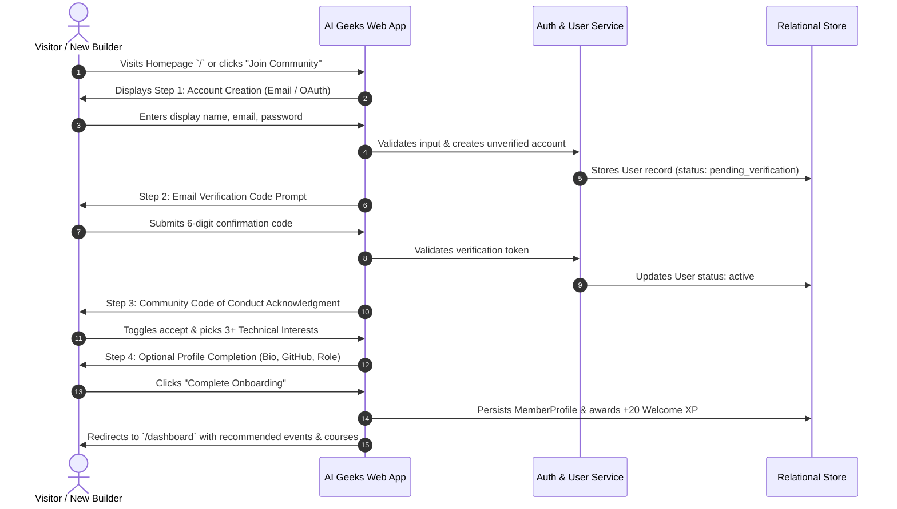
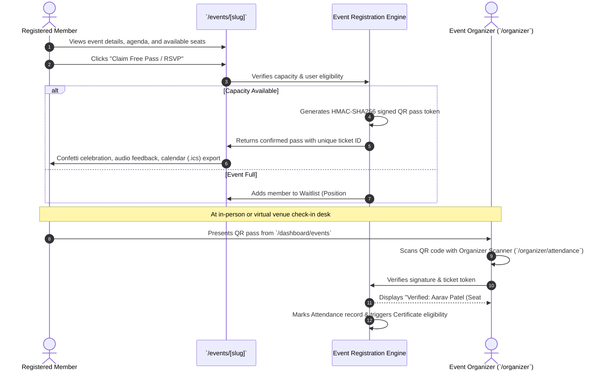
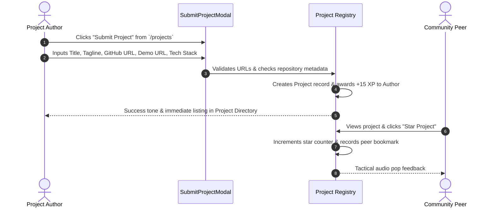
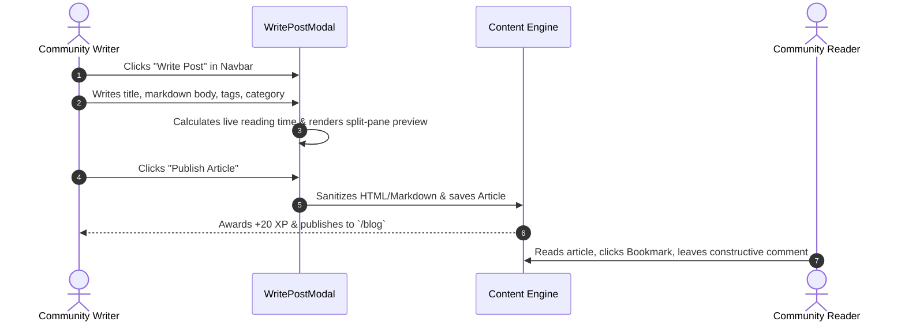
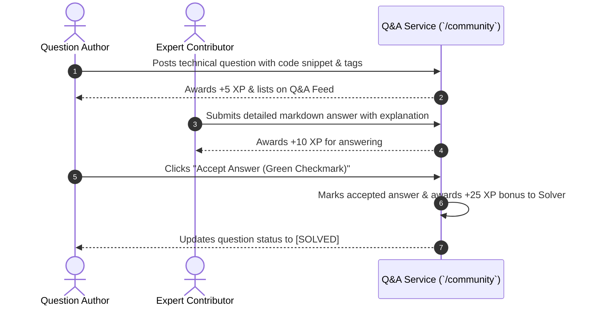

# Core User Journeys & Interaction Flows
**Project:** AI Geeks Tech Community  
**Document ID:** `DOCS-DES-003`  
**Reference Date:** November 17, 2026  
**Status:** Validated User Flows  

---

## 1. Flow 1: Visitor Discovery & Resumable 4-Step Onboarding

---

## 2. Flow 2: Event Discovery, RSVP, Cryptographic QR Pass & Check-in

---

## 3. Flow 3: Open-Source Project Showcase & Star Engagement

---

## 4. Flow 4: Technical Article Authoring & Publishing

---

## 5. Flow 5: Q&A Question Asking & Accepted Solution Resolution

