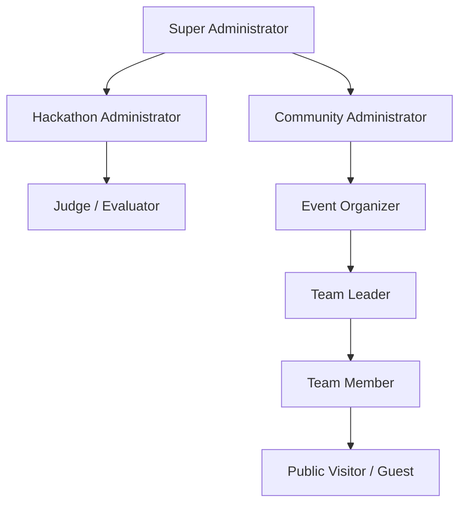

# AI GEEKS Role-Based Access Control (RBAC) & Permissions

**Project:** AI GEEKS Community Platform  
**Governance Context:** `src/components/providers/InternalAccessProvider.tsx`  
**Security Standard:** Principle of Least Privilege & Server-Side Enforcement  

---

## 1. Role Hierarchy

---

## 2. Permissions Matrix

| Capability / Route | Super Admin | Hackathon Admin | Organizer | Evaluator | Team Leader | Team Member | Public |
|---|:---:|:---:|:---:|:---:|:---:|:---:|:---:|
| View Public Community Website | ✅ | ✅ | ✅ | ✅ | ✅ | ✅ | ✅ |
| RSVP for Meetups & Talks | ✅ | ✅ | ✅ | ✅ | ✅ | ✅ | ✅ |
| View Published Problem Statements | ✅ | ✅ | ✅ | ✅ | ✅ | ✅ | ✅ |
| Select Problem Statement | ❌ | ❌ | ❌ | ❌ | ✅ (Leader) | ❌ (Read Only) | ❌ |
| Submit Hackathon Deliverables | ❌ | ❌ | ❌ | ❌ | ✅ | ✅ | ❌ |
| Review Team Submissions | ✅ | ✅ | ✅ | ✅ | ❌ | ❌ | ❌ |
| Submit Judge Scoring & Rubrics | ✅ | ✅ | ❌ | ✅ | ❌ | ❌ | ❌ |
| Manage Team Status Lifecycles | ✅ | ✅ | ✅ | ❌ | ❌ | ❌ | ❌ |
| Access Global Admin Hackathons | ✅ | ✅ | ✅ | ❌ | ❌ | ❌ | ❌ |
| View Unmasked Participant Emails | ✅ | ✅ | ❌ | ❌ | ❌ (Own Only) | ❌ | ❌ |
| Modify Site-Wide Access Controls | ✅ | ❌ | ❌ | ❌ | ❌ | ❌ | ❌ |

---

## 3. Server-Side Enforcement (`/api/admin/hackathons`)

- **Role Verification:** Incoming POST requests inspect the `x-user-role` header or session cookie.
- **Unauthorized Handling:** Requests lacking valid administrator or evaluator credentials receive an immediate `HTTP 403 Forbidden` response.
- **Privacy Masking:** When fetching team rosters, non-administrative callers receive sanitized email fields (e.g., `d***@domain.com`).
