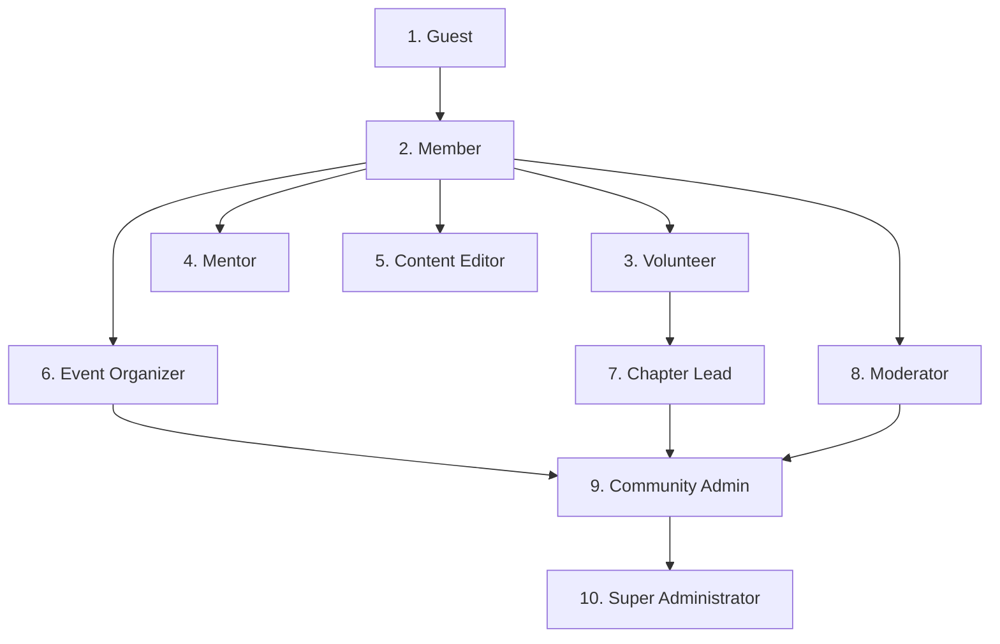

# Product Requirements Document (PRD): AI Geeks Community Platform
**Project:** AI Geeks — The Next-Generation Global Technology Community Platform  
**Document ID:** `DOCS-PLAN-001`  
**Reference Date:** November 17, 2026  
**Status:** Approved Specification  

---

## 1. Vision & Strategic Positioning

### Community Name
**AI Geeks** (AI Geeks Tech Community)

### Tagline
*"Learn. Build. Innovate. Together."*

### Mission Statement
To connect curious minds with the people, knowledge, projects, and opportunities needed to build meaningful, transformative technology.

### Brand Personality
- **Technically Sophisticated:** Grounded in rigorous engineering, systems thinking, and emerging AI research.
- **Welcoming to Beginners:** Progressive complexity disclosure, supportive onboarding, and clear pathways from novice to builder.
- **Developer-First:** Code snippets, terminal vibes, monospace metadata, dark-mode ergonomics, and minimal marketing fluff.
- **Research-Oriented:** Respect for original research, formal citations, reproducibility, and ethical AI development.
- **Community-Driven:** Decentralized chapters, public recognition, peer reviews, and transparent governance.
- **Trustworthy & Verified:** Zero fabricated metrics; all statistics, certificates, and achievements are tied to persistent records.

---

## 2. Target Personas

1. **The Aspiring Student / Beginner (Alex, 20):**
   - *Goal:* Break into AI and software engineering, find hands-on learning roadmaps, connect with mentors, and earn verified certificates.
   - *Needs:* Structured learning academy (`/learn`), beginner-friendly tags, hackathon team matching, and resume project showcases.
2. **The Senior Software Architect / ML Engineer (Priya, 31):**
   - *Goal:* Share architectural patterns, publish technical deep dives, stay ahead of agentic workflows, and discover bleeding-edge open-source tools.
   - *Needs:* High-signal technical blog (`/blog`), Q&A with accepted answers (`/community`), and project showcase (`/projects`).
3. **The Chapter Organizer / Campus Lead (David, 24):**
   - *Goal:* Launch and run an active local chapter or campus club, host meetups, and verify attendee check-ins.
   - *Needs:* Organizer portal (`/organizer`), event creation, capacity waitlists, and cryptographic QR check-in scanning.
4. **The Technical Founder / Hiring Sponsor (Elena, 38):**
   - *Goal:* Discover exceptional builder talent, sponsor flagship hackathons, and post verified engineering opportunities.
   - *Needs:* Opportunities board (`/opportunities`), partner showcase (`/partners`), and project innovation lab (`/labs`).
5. **The Community Administrator / Moderator (Rohan, 28):**
   - *Goal:* Safeguard community culture, moderate flagged posts, approve new chapters, and review system audit logs.
   - *Needs:* Unified Admin Command Center (`/admin`), granular RBAC, and immutable audit logs.

---

## 3. The 20 Structured Topic Categories

Implemented as manageable database records rather than hardcoded client strings:

| ID | Slug | Display Name | Technical Focus |
| :--- | :--- | :--- | :--- |
| `cat-01` | `artificial-intelligence` | **Artificial Intelligence** | General AI, symbolic reasoning, heuristic search |
| `cat-02` | `ml-deep-learning` | **Machine Learning & Deep Learning** | Neural architectures, PyTorch, backprop, transformers |
| `cat-03` | `genai-llms` | **Generative AI & LLMs** | Fine-tuning, RLHF, prompt engineering, model alignment |
| `cat-04` | `ai-agents` | **AI Agents & Agentic Systems** | Tool use, autonomous loops, ReAct, multi-agent swarms |
| `cat-05` | `fullstack-dev` | **Full-Stack Development** | React 19, Next.js, Node.js, WebGPU, local-first state |
| `cat-06` | `cloud-devops` | **Cloud Computing & DevOps** | Kubernetes, serverless, Terraform, CI/CD, multi-region |
| `cat-07` | `data-science` | **Data Science & Analytics** | Feature engineering, Polars, DuckDB, data pipelines |
| `cat-08` | `cybersecurity` | **Cybersecurity** | AppSec, penetration testing, zero-trust, cryptography |
| `cat-09` | `blockchain-web3` | **Blockchain & Web3** | Smart contracts, distributed consensus, zero-knowledge proofs |
| `cat-10` | `quantum-computing` | **Quantum Computing** | Qubits, quantum algorithms, Qiskit, error correction |
| `cat-11` | `robotics-automation` | **Robotics & Automation** | ROS2, kinematics, computer-aided perception, actuators |
| `cat-12` | `iot` | **Internet of Things** | Edge sensors, MQTT, embedded connectivity, ESP32 |
| `cat-13` | `neurotechnology` | **Neurotechnology & Neuroscience** | Brain-computer interfaces, neural signal decoding, EEG |
| `cat-14` | `space-technology` | **Space Technology** | Orbital mechanics, satellite telemetry, remote sensing |
| `cat-15` | `open-source` | **Open-Source Engineering** | Git workflows, licensing, maintainership, community PRs |
| `cat-16` | `computer-vision` | **Computer Vision** | Object detection, segmentation, diffusion visual models |
| `cat-17` | `nlp` | **Natural Language Processing** | Tokenization, semantic embeddings, vector search |
| `cat-18` | `embedded-systems` | **Embedded Systems** | Rust for embedded, RTOS, microcontrollers, FPGA |
| `cat-19` | `tech-entrepreneurship` | **Technology Entrepreneurship** | Product-market fit, developer GTM, open-core business |
| `cat-20` | `emerging-research` | **Emerging Research** | Preprints, theoretical papers, novel physical architectures |

---

## 4. Functional Scope Matrix by User Role

The platform enforces 10 discrete roles with strictly scoped capabilities:

1. **Guest (Public Visitor):**
   - Browse public pages: Home, About, Team, Chapters, Events, Projects, Learn, Research, Blog, Opportunities, Gallery, Policies.
   - Perform read-only search via Command Palette (`⌘K`).
   - Initiate registration / login flow.
   - Verify digital certificates via `/verify/[certificateId]`.
2. **Member (Verified Builder):**
   - Access personal `/dashboard` (Profile, My Events, My Projects, My Learning, Achievements, Settings).
   - Register for events, receive signed attendance QR passes, and export calendar links.
   - Submit open-source projects for showcase listing (+15 XP).
   - Author technical articles and tutorials in Markdown (+20 XP).
   - Post Q&A questions (+5 XP) and answer technical questions (+10 XP).
   - Enroll in learning academy tracks and track completed modules (+25 XP per course).
   - Star projects, bookmark articles, and react with constructive feedback.
   - Apply for open opportunities, hackathons, and mentorship pairings.
3. **Volunteer:**
   - Assist at assigned chapter events and community booth operations.
   - View assigned volunteer tasks in the member dashboard.
4. **Mentor:**
   - Maintain public mentor profile with expertise, office hours, and availability.
   - Accept or decline incoming mentorship pairing requests from members.
5. **Content Editor:**
   - Review and publish community blog submissions and research summaries.
   - Edit homepage announcements and curate featured project showcases.
6. **Event Organizer:**
   - Access `/organizer` portal.
   - Create, update, publish, and cancel assigned chapter events.
   - Manage event registration lists, capacity limits, and waitlists.
   - Scan and validate attendee QR check-in tokens at in-person venues.
   - Issue post-event participation certificates to verified attendees.
7. **Chapter Lead:**
   - Manage local/campus chapter profile, organizers, and contact channels.
   - Coordinate regional events and submit annual chapter activity reports.
8. **Moderator:**
   - Access moderation queue in `/admin/moderation`.
   - Review flagged discussions, spam reports, and abusive comments.
   - Hide, lock, or remove offending content with audit trail logging.
9. **Community Administrator:**
   - Access full Admin Command Center (`/admin`).
   - Manage user role assignments, approve new chapters, and review partner sponsorships.
   - Review platform analytics (active members, event attendance, learning completion).
10. **Super Administrator:**
    - Full system root permissions: manage system settings, feature flags, database backups, and security audit logs.
