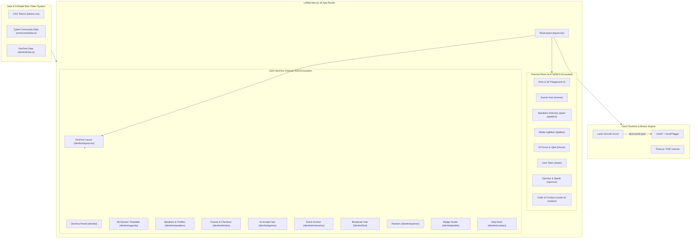
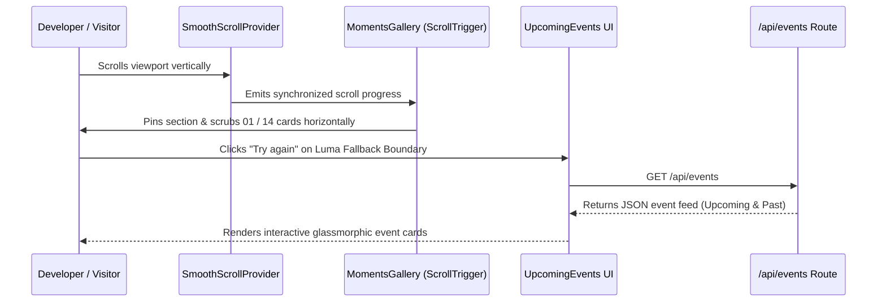
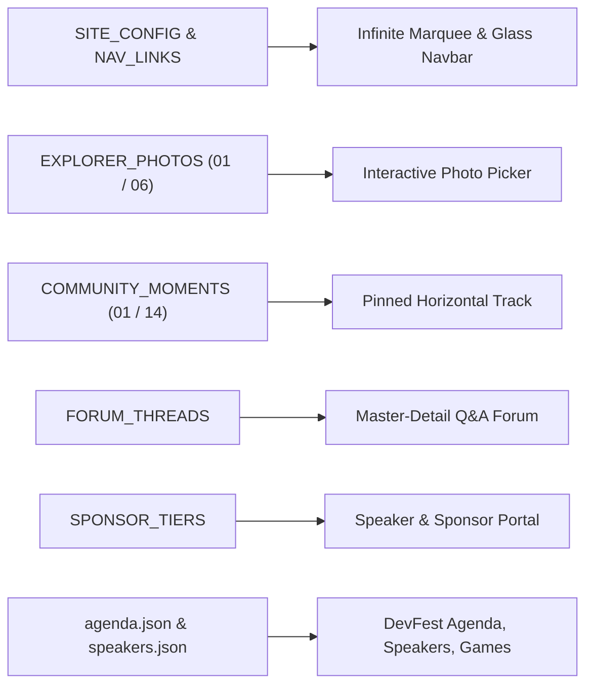

<div align="center">
  

  <br />

  
  
  
  
  
  
</div>


## Overview

**AI GEEKS** is a unified developer community platform engineered with **Next.js 16 (App Router)**, **React 19**, **TypeScript**, **Tailwind CSS v4**, **GSAP ScrollTrigger**, and **Lenis** smooth scroll physics. The platform unites two premier developer ecosystems into one seamless experience with a shared zero-border, **9-Shade Blue Glassmorphic Design System**:

1. **Chennai React JS Community Experience (`/`)**:
   - Parallax Hero with iconic Chennai Central & Marina Beach motifs.
   - DevFestBot interactive 3D Mascot Playground (`@react-three/fiber` + `@react-three/drei`).
   - ReactBits draggable Sticker Peel interactive dock.
   - Live Luma community meetups feed, upcoming talks, and DSC VIT-inspired organizing team grid.
   - Dual Opposing Marquees for real-time community tweets and LinkedIn highlights.
   - Napier Bridge-themed multi-channel social footer.

2. **GDG DevFest Chennai 2026 Experience (`/devfest`)**:
   - Forensic clone and native integration of the official DevFest Chennai 2026 web application.
   - Interactive 3D Brackets background with performance mode toggle (`?lite=1`).
   - 8 Technical Specialization Tracks (GenAI, Cloud, Android, Web, Security, DevOps, etc.).
   - Full 68-session Timetable & Agenda with hall filtering, track pills, and session bookmarking.
   - 29-Speaker Keynote Directory with deep-linked bio modals and individual speaker profile pages (`/devfest/speakers/[slug]`).
   - Tiered Digital Pass Selector (`/devfest/tickets`) with KonfHub-style registration (`/devfest/tickets/select`).
   - 4 Browser Mini-Games (`/devfest/games`): Jigsaw Puzzle, Google Crossword, Memory Matrix, Syntax Speed Typer with live XP.
   - 15-Photo High-Resolution Event Memories Archive (`/devfest/memories`) across 2025, 2024, and 2023.
   - Multi-Stage Live Broadcast Center (`/devfest/live`) with real-time emoji reactions and simulated chat.
   - Community Partners Showcase (`/devfest/partner`) and Digital Badge Customization Studio (`/devfest/profile`).


## System & Component Architecture

The unified platform separates static and dynamic rendering across the Next.js 16 App Router, synchronizing smooth scroll inertia with pinned GSAP timelines, WebGL particle canvases, and a centralized TypeScript data layer.



### Interactive Scroll & Luma Feed Lifecycle



### Community Feature & Data Flow




## 9-Shade Blue Glassmorphic Color System

Every surface, border, gradient, and glow state in the repository is strictly mapped to nine hex shades defined in **src/styles/tokens.css**.

| CSS Custom Property | Hex Code | Palette Name | Primary Architectural Role |
| :--- | :--- | :--- | :--- |
| --ag-bg-abyss | #000521 | Abyssal Navy | Primary viewport background canvas |
| --ag-bg-void | #020024 | Midnight Void | Alternating section and footer canvas |
| --ag-bg-obsidian | #020C47 | Obsidian Royal | Elevated glassmorphic card base |
| --ag-bg-cyber | #0A1A2F | Cyber Slate Navy | Translucent surface panel tint |
| --ag-blue-imperial | #011F65 | Imperial Cobalt | Active route pills and secondary buttons |
| --ag-blue-sapphire | #0E4EB2 | Core Sapphire | Interactive hover fill and CTA midpoint |
| --ag-blue-azure | #2078CF | Vibrant Azure | Primary CTA gradient lead and borders |
| --ag-cyan-electric | #00D4FF | Electric Cyan | Monospace eyebrows, badges, and rim glows |
| --ag-neutral-carbon | #1F1F1F | Carbon Dark | Terminal header bars, code blocks, and dividers |


## Route & Module Matrix

### Primary AI GEEKS & Chennai React Routes

| Route Path | Source File | Interactive Capabilities |
| :--- | :--- | :--- |
| `/` | `src/app/page.tsx` | Parallax Hero, 3D Mascot Playground, Sticker Peel, Luma feed, GSAP gallery |
| `/about` | `src/app/about/page.tsx` | Community pillars, 10k+ member metrics, and builder mission |
| `/events` | `src/app/events/page.tsx` | Upcoming and past meetup tabs wired to the Luma API handler |
| `/past-speakers` | `src/app/past-speakers/page.tsx` | Live text search and category filtering across speaker sessions |
| `/gallery` | `src/app/gallery/page.tsx` | Photo and video media archive with modal lightbox player |
| `/forum` | `src/app/forum/page.tsx` | Master-detail AI Q&A forum with upvotes, thread creation, and replies |
| `/team` | `src/app/team/page.tsx` | 17-member core organizing team grid with role badges |
| `/sponsor` | `src/app/sponsor/page.tsx` | Sponsorship prospectus tiers and speaker proposal onboarding form |
| `/code-of-conduct` | `src/app/code-of-conduct/page.tsx` | Community safety standards and enforcement guidelines |
| `/join` | `src/app/join/page.tsx` | Community membership onboarding with interest tags and pass generation |
| `/hackathon-showcase` | `src/app/hackathon-showcase/page.tsx` | Live project submissions, demo links, and judge scoring matrix |
| `/settings` | `src/app/settings/page.tsx` | User preferences, theme controls, and notification settings |

### GDG DevFest Chennai 2026 Routes

| Route Path | Source File | Interactive Capabilities |
| :--- | :--- | :--- |
| `/devfest` | `src/app/devfest/page.tsx` | Particle hero, 8 tech tracks, mini-games preview, keynotes, venue map |
| `/devfest/agenda` | `src/app/devfest/agenda/page.tsx` | Interactive 68-session timetable with hall filters, track pills, and search |
| `/devfest/speakers` | `src/app/devfest/speakers/page.tsx` | 29 keynote speakers directory with bio modal and talk cross-links |
| `/devfest/speakers/[slug]` | `src/app/devfest/speakers/[slug]/page.tsx` | Dynamic individual speaker profile page with full session details |
| `/devfest/tickets` | `src/app/devfest/tickets/page.tsx` | Tiered pass selector (Student, Pro, Women in Tech, VIP) with badge generator |
| `/devfest/tickets/select` | `src/app/devfest/tickets/select/page.tsx` | KonfHub-style profile matching and pass tier selection step |
| `/devfest/games` | `src/app/devfest/games/page.tsx` | 4 browser games (Jigsaw, Crossword, Memory Matrix, Typer) with live XP |
| `/devfest/memories` | `src/app/devfest/memories/page.tsx` | 15-photo high-resolution event archive (2025, 2024, 2023) with lightbox |
| `/devfest/live` | `src/app/devfest/live/page.tsx` | Multi-stage broadcast center with emoji reactions and simulated live chat |
| `/devfest/partner` | `src/app/devfest/partner/page.tsx` | Community partners and alliance showcase (GDG Cloud, UAI, Grafana, etc.) |
| `/devfest/profile` | `src/app/devfest/profile/page.tsx` | Digital attendee badge studio with customizable name, role, accent, QR |
| `/devfest/contact` | `src/app/devfest/contact/page.tsx` | Help desk and inquiry contact form |


## Quick Start & Automated Verification

1. **Install Dependencies**
   ```bash
   npm install
   ```

2. **Start the Unified Development Server**
   ```bash
   npm run dev
   ```
   - Primary AI GEEKS / Chennai React: `http://localhost:3000/`
   - DevFest Chennai 2026 Portal: `http://localhost:3000/devfest`

3. **Run the Automated Verification Suite**
   ```bash
   npm run verify:readme
   npm run verify:clone
   npm run typecheck
   npm run build
   ```
